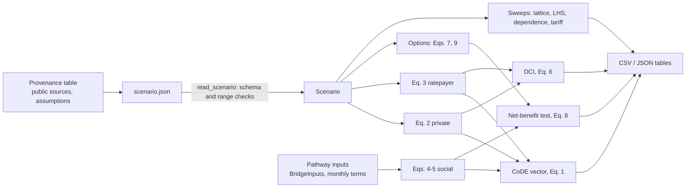

# Architecture

## Modules

| Module | Content |
|---|---|
| `parameters.py` | `Project`, `PrivateInputs`, `RatepayerInputs`, `Scenario` (frozen dataclasses, validated on creation); financing rules for $\phi_u$, $\phi_s$; `set_parameter` / `get_parameter` by path; unit helper for USD/kW-month |
| `accounting.py` | Eqs. (1)–(10): `discount_factor`, `deployment_fraction`, `private_cost`, `private_monthly`, `ratepayer_cost`, `ratepayer_delay_cost`, `social_cost`, `emissions_social_cost`, `code_vector`, `delay_cost_intensity`, `avoided_cost`, `net_benefit`, `distributionally_acceptable`, `staged_private_cost`, `realization_decomposition` |
| `pathways.py` | `BridgeInputs`, `bridge_pathway` (Eq. 5 with Eqs. 7–8 for a temporary-supply pathway); `acceleration_options` (full-service and staged options); emission-factor conversion |
| `dependence.py` | `realization_curve` ($q_\beta$), `dependence_stress` |
| `sweeps.py` | `full_factorial`, `latin_hypercube`, `sample_scenarios`, `evaluate`, `rank_correlations`, `percentiles_by`, `tariff_cases` |
| `io.py` | scenario files (JSON) with schema checks; CSV tables |
| `illustrative.py` | invented round inputs for the examples and tests |
| `cli.py` | `code-delay example / run / sweep / lhs / staged` |

## Data flow

## Computation

Every quantity is a closed-form present value; there is no optimization and no solver. The discounted sums $\sum_t d_t$ and $\sum_t d_t \alpha_t$ are cached per (delay, rate, profile, peak), so a ten-dimensional lattice of about 10⁵ cases builds and evaluates in about ten seconds on a laptop, most of it in creating the scenario objects.

## Output tables

See [data_pipeline.md](data_pipeline.md#output-tables). All money columns are present values in USD at the planned service date.

## Tests

`pytest` runs the suite in `tests/`:

- equations against hand-computed values: discounting, the four deployment profiles, Eq. (2) term by term (including which terms carry the $q$ weight), Eq. (3) and its $\tau = 0$ stock, the three financing rules, Eqs. (4)–(5), Eq. (6), Eq. (7) (the stock cancels), Eq. (8), Eq. (9) (limits $f = 0$, $f = 1$, $\tau_e = \tau_0$, and a custom $g$), Eq. (10) (the decomposition adds up; elasticity bounds);
- pathway and stress tools: bridge energy, emissions and the avoided private cost of the bridged months, the implementation-cost bound; $q_\beta$ (anchor, cap, monotonicity) and the two ratepayer differentials;
- scenario sets: lattice size and content, Latin hypercube strata and seed, Spearman coefficients against a direct computation, categorical dummies;
- data interface: JSON round trip; unknown, missing, non-finite and out-of-range fields; financing-rule fields;
- command line and the minimal example.
